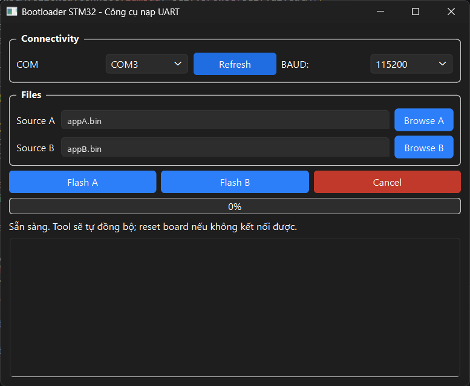
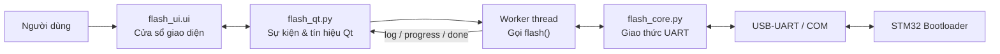
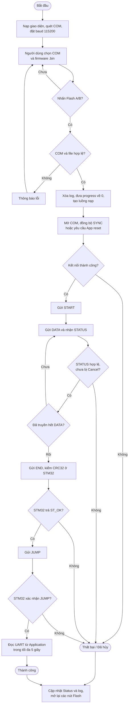
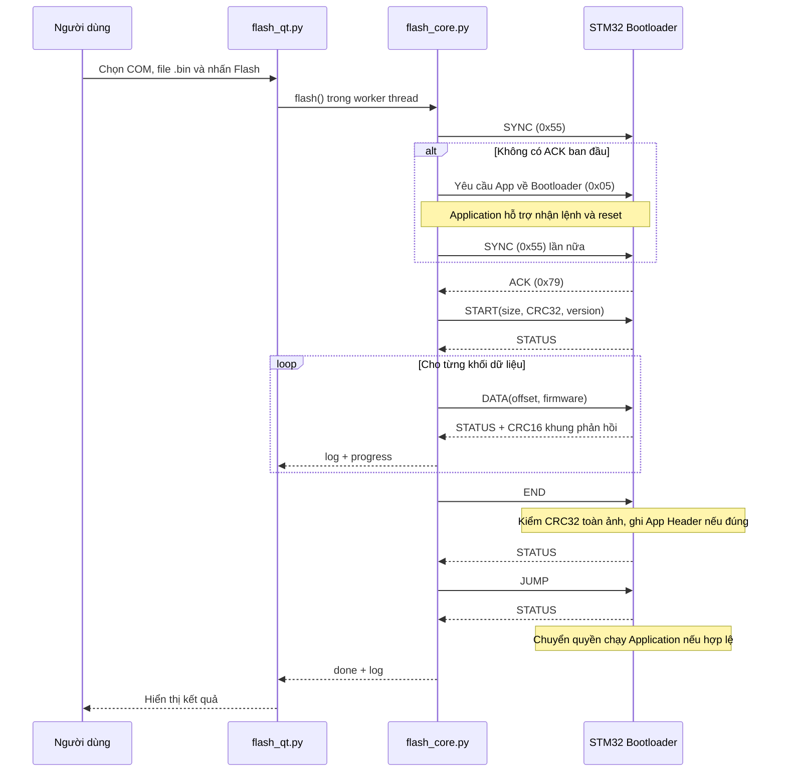

# Giao diện Bootloader STM32 – Công cụ nạp firmware qua UART

## Mục tiêu

Phần **giao diện** của dự án giúp nạp và cập nhật firmware cho **STM32F103C8T6** từ máy tính thông qua cổng UART, thay vì phải nạp lại chương trình ứng dụng bằng ST-Link mỗi lần thay đổi. Người dùng có thể chọn cổng COM, chọn file `.bin`, theo dõi tiến trình và xem thông báo từ Bootloader hoặc Application ngay trên cửa sổ phần mềm.

Công cụ được phát triển bằng **Python**, sử dụng **PySide6 (Qt)** để tạo giao diện và **PySerial** để trao đổi dữ liệu qua USB-UART. Chương trình phối hợp với Bootloader trên STM32 để đồng bộ kết nối, truyền firmware, kiểm tra lỗi và yêu cầu chạy ứng dụng sau khi cập nhật thành công.

> **Phạm vi:** README này mô tả phần mềm trong thư mục `giaodien/`, tập trung vào cách người dùng thao tác và cách chương trình PC làm việc. Các thuật toán xóa/ghi Flash được Bootloader thực thi ở phía STM32, không phải trong Python.

## 1. Giao diện trực quan



*Hình 1. Giao diện công cụ nạp firmware qua UART (đường dẫn file trên ảnh đã được thay bằng tên mẫu).*

| Thành phần | Chức năng |
|---|---|
| **COM** | Chọn cổng nối tiếp kết nối tới module USB-UART. |
| **Refresh** | Quét lại các cổng COM đang có trên máy tính. |
| **BAUD** | Tốc độ UART; bản hiện tại sử dụng `115200` bps. |
| **Source A / Source B** | Đường dẫn tới hai file firmware `.bin` để thử nạp luân phiên. |
| **Browse A / Browse B** | Chọn file từ máy tính. |
| **Flash A / Flash B** | Bắt đầu nạp firmware tương ứng. |
| **Cancel** | Gửi yêu cầu dừng phiên nạp đang chạy. |
| **Progress bar** | Hiển thị tỷ lệ các gói lệnh đã được STM32 xác nhận. |
| **Status / Log** | Thông báo trạng thái tổng quát và nhật ký chi tiết quá trình nạp. |

## 2. Cấu trúc mã nguồn

```text
giaodien/
├── flash_ui.ui       # Bố cục giao diện Qt
├── flash_qt.py       # Xử lý nút bấm, worker thread, log và progress
├── flash_core.py     # Chuẩn bị file .bin, đóng gói UART, gửi lệnh, đọc phản hồi
├── appA.bin          # Firmware A (người dùng cung cấp)
├── appB.bin          # Firmware B (người dùng cung cấp)
├── README.md
└── assets/
    └── giao_dien.png
```

**Vai trò của từng file:**

1. `flash_ui.ui` mô tả các ô chọn COM, đường dẫn firmware, nút Flash/Cancel, thanh tiến trình và vùng log.
2. `flash_qt.py` nạp file giao diện bằng `QUiLoader`, kết nối sự kiện từ các nút và khởi tạo luồng nền để nạp firmware. File này **không trực tiếp xử lý CRC hay khung UART**.
3. `flash_core.py` đọc firmware, kiểm tra vector table, tính CRC, giao tiếp UART bằng PySerial, nhận mã trạng thái từ STM32 và tạo thông báo gửi lại cho giao diện.



## 3. Cài đặt và chạy chương trình

### 3.1. Yêu cầu

- Máy tính đã cài **Python 3** phù hợp với PySide6.
- Thư viện **PySide6** và **PySerial**.
- Board **STM32F103C8T6** đã được nạp Bootloader tương thích với giao thức của dự án.
- Module **USB-UART mức logic 3,3 V**, dây nối và một hoặc hai file firmware `.bin` dành cho vùng Application.

Cài thư viện:

```bash
python -m pip install PySide6 pyserial
```

### 3.2. Kết nối phần cứng

| Module USB-UART | STM32F103C8T6 |
|---|---|
| TX | PA10 (USART1_RX) |
| RX | PA9 (USART1_TX) |
| GND | GND |

Cấp nguồn cho board theo phần cứng đang sử dụng. Phải **nối chung GND**, đấu chéo TX/RX và bảo đảm mức điện áp UART tương thích 3,3 V.

### 3.3. Khởi chạy

Mở Terminal/PowerShell trong thư mục `giaodien/`:

```bash
python flash_qt.py
```

Trên Windows cũng có thể dùng:

```powershell
py flash_qt.py
```

> Chạy `flash_qt.py` khi `flash_ui.ui` và `flash_core.py` nằm cùng thư mục. Hai file `appA.bin`, `appB.bin` là đường dẫn mặc định gợi ý; nếu không có chúng, có thể chọn file khác bằng **Browse A/B**.

### 3.4. Các bước sử dụng

1. Kết nối module USB-UART với STM32, sau đó mở công cụ.
2. Chọn đúng **COM**; nhấn **Refresh** nếu chưa thấy cổng cần dùng.
3. Kiểm tra **BAUD = 115200**.
4. Chọn file `.bin` tại **Source A** hoặc **Source B**.
5. Nhấn **Flash A** hoặc **Flash B**.
6. Theo dõi thanh tiến trình và vùng **Log** để biết kết quả từng bước.
7. Khi nạp thành công, Bootloader xác nhận lệnh **JUMP** và chuyển quyền điều khiển sang Application.

## 4. Lưu đồ thuật toán của giao diện

Lưu đồ dưới đây mô tả luồng xử lý chính trong `flash_qt.py` và `flash_core.py`. Các nhánh lỗi/Cancel kết thúc phiên nạp và trả quyền thao tác cho người dùng.



**Giải thích ngắn gọn:** Chương trình kiểm tra thông tin đầu vào trước khi bắt đầu nạp. Nếu hợp lệ, `flash_qt.py` chạy hàm `flash()` ở luồng nền. Hàm này đồng bộ UART, lần lượt gửi các lệnh `START`, `DATA`, `END`, `JUMP` và chỉ tiếp tục khi nhận phản hồi thích hợp. Kết quả được chuyển ngược về giao diện để cập nhật log, tiến trình và trạng thái.

## 5. Nguyên lý nhận và hiển thị log từ STM32

Dữ liệu đi theo chuỗi sau:

```text
STM32 USART1_TX (PA9)
       |
       v
Module USB-UART --> Cổng COM trên máy tính
       |
       v
flash_core.py: ser.read(), _read_response()
       |
       v
Kiểm tra SOF / EOF / CRC16 / CMD / STATUS
       |
       v
Chuyển STATUS thành thông báo --> on_log(...)
       |
       v
flash_qt.py: Bridge.log.emit(...)
       |
       v
self.ui.tedt.appendPlainText(...) --> Hiển thị log
```

### 5.1. STM32 gửi phản hồi dưới dạng byte

Bootloader **không gửi nguyên một câu thông báo lỗi tiếng Việt**. Thay vào đó, nó gửi khung phản hồi nhị phân gồm mã lệnh và mã trạng thái; máy tính đọc và diễn giải chúng.

`flash_core.py` đọc khung phản hồi bằng hàm `_read_response()`:

```python
first = _read_exact(ser, 1, deadline, stop_event)
if first[0] != SOF:
    continue

rest = _read_exact(ser, 5, deadline, stop_event)
cmd, status = rest[:2]
received_crc = struct.unpack("<H", rest[2:4])[0]

if rest[4] != EOF or received_crc != crc16(bytes([cmd, status])):
    raise ProtocolError("Phản hồi bootloader sai CRC16/EOF.")
```

- `_read_exact()` tiếp tục đọc cho tới khi đủ số byte yêu cầu hoặc hết thời gian chờ.
- Byte đầu phải là `SOF = 0xA5`, tiếp theo là 5 byte còn lại.
- Chương trình kiểm tra `EOF = 0x5A`, CRC16 và mã lệnh phản hồi.
- Nếu hợp lệ, `_read_response()` trả về `status` cho hàm gọi.

### 5.2. Mã trạng thái được chuyển thành log

Ví dụ: STM32 trả `STATUS = 8`, tương ứng lỗi CRC32 toàn bộ firmware. Hàm `_status_message(8)` sẽ tạo chuỗi **`CRC32 ảnh không khớp`**.

Trong quá trình xử lý lệnh, chương trình gọi `on_log(...)` để tạo thông báo. `flash_qt.py` đã truyền `self.br.log.emit` vào hàm `flash()` như callback `on_log`:

```python
self.br.log.connect(self.ui.tedt.appendPlainText)

# Trong worker thread:
ok = flash(
    port, baud, path, corrupt,
    self.br.progress.emit,
    self.br.log.emit,
    self.stop_event,
)
```

Do đó, khi `flash_core.py` gọi `on_log("Đã kết nối bootloader.")`, tín hiệu `log` sẽ chuyển chuỗi đến `appendPlainText()` để thêm một dòng vào ô nhật ký của giao diện. Cơ chế **Qt Signal/Slot** giúp cập nhật widget từ luồng giao diện chính, không cần thao tác trực tiếp trên widget từ worker thread.

### 5.3. Đọc chuỗi UART từ Application

Sau khi STM32 xác nhận `JUMP`, chương trình tiếp tục đọc dữ liệu UART từ Application trong tối đa **5 giây**:

```python
chunk = ser.read(max(1, ser.in_waiting))
if chunk:
    output.extend(chunk)
```

Dữ liệu nhận được được chuyển từ `bytes` thành chuỗi bằng `decode("utf-8", errors="replace")` và gửi qua `on_log(...)`.

**Lưu ý:** Đây là chế độ đọc phản hồi **trong khoảng thời gian ngắn sau khi nạp**, không phải chương trình Serial Monitor liên tục. Không nhận được dữ liệu Application trong 5 giây không đồng nghĩa firmware chắc chắn không chạy.

## 6. Giao thức UART giữa giao diện và Bootloader

### 6.1. Định dạng khung dữ liệu

Khung yêu cầu từ PC:

```text
┌─────┬─────┬────────────┬─────────────────┬────────────┬─────┐
│ SOF │ CMD │ LEN (2 B)  │ PAYLOAD (N B)   │ CRC16 (2 B)│ EOF │
└─────┴─────┴────────────┴─────────────────┴────────────┴─────┘
```

Khung phản hồi từ STM32:

```text
┌─────┬─────┬────────┬────────────┬─────┐
│ SOF │ CMD │ STATUS │ CRC16 (2 B)│ EOF │
└─────┴─────┴────────┴────────────┴─────┘
```

| Trường | Ý nghĩa |
|---|---|
| `SOF = 0xA5` | Đánh dấu đầu khung. |
| `CMD` | Lệnh gửi xuống hoặc lệnh được phản hồi. |
| `LEN` | Độ dài `PAYLOAD`, 2 byte little-endian. |
| `PAYLOAD` | Tham số lệnh hoặc dữ liệu firmware. |
| `CRC16` | Kiểm tra lỗi trên `CMD + LEN + PAYLOAD` (yêu cầu), hoặc `CMD + STATUS` (phản hồi). |
| `STATUS` | Trạng thái xử lý do Bootloader trả về. |
| `EOF = 0x5A` | Đánh dấu kết thúc khung. |

**Bắt tay SYNC** sử dụng byte đơn `0x55` và phản hồi ACK `0x79`, tách biệt với các khung lệnh nêu trên.

### 6.2. Các lệnh chính

| CMD | Giá trị | Vai trò |
|---|---|---|
| `START` | `0x01` | Mở phiên nạp, gửi kích thước firmware, CRC32 và phiên bản. |
| `DATA` | `0x02` | Gửi offset (4 byte) và một khối dữ liệu ứng dụng. |
| `END` | `0x03` | Yêu cầu kiểm tra CRC32 toàn firmware và ghi App Header nếu hợp lệ. |
| `JUMP` | `0x04` | Yêu cầu chuyển sang chạy Application. |
| `REBOOT_BL` | `0x05` | Gói yêu cầu đặc biệt do PC gửi tới **Application đang chạy**, để Application reset về Bootloader. |

`START` sử dụng payload gồm **12 byte**: `size (4) + crc32 (4) + version (4)`; phía giao diện hiện gửi `version = 0`.

`DATA` sử dụng payload gồm `offset (4 byte) + data`. Với phiên bản công cụ nạp **1024 byte/gói**, một khung DATA đầy đủ có 1024 byte firmware và 4 byte offset (chưa tính các byte bao khung).

### 6.3. Trình tự nạp qua UART



Nếu MCU đang chạy Application mà không phản hồi `SYNC`, công cụ thử gửi yêu cầu `REBOOT_BL` và đồng bộ lại. Đây là **yêu cầu reset bằng phần mềm gửi qua UART**, không phải phần mềm PC tự điều khiển chân reset vật lý của board.

## 7. Kiểm tra firmware trước khi truyền

`flash_core.py` chuẩn bị file `.bin` trước khi mở cổng COM:

1. Đọc toàn bộ file bằng `prepare_image(path)`.
2. Nếu phát hiện file có trang Header do Linker sinh ra và vector ứng dụng hợp lệ ở sau trang đó, tự bỏ **1024 byte Header đầu tiên**.
3. Kiểm tra file không rỗng, kích thước tối đa **47 KiB = 48.128 byte**, đồng thời kích thước phải chia hết cho 4.
4. Kiểm tra vector table: địa chỉ MSP hợp lệ trong SRAM và địa chỉ Reset_Handler thuộc vùng Application bắt đầu tại `0x08004400`, có bit Thumb hợp lệ.
5. Tính CRC32 phù hợp với thuật toán sử dụng trên STM32 để gửi trong lệnh START.

**CRC16 và CRC32 có hai nhiệm vụ khác nhau:**

- **CRC16** phát hiện lỗi từng khung giao tiếp UART. Khi trả về `ST_ERR_FRAME`, PC có thể truyền lại gói lệnh.
- **CRC32** được kiểm tra khi nhận lệnh `END`, dùng để đánh giá tính toàn vẹn của toàn bộ firmware đã ghi xuống Flash.

CRC32 trong dự án được tính để khớp với phần cứng/thuật toán của STM32; **không nên tự thay bằng `zlib.crc32()`** khi chưa đối chiếu cách xử lý dữ liệu.

## 8. Truyền lại, Cancel và cập nhật tiến trình

### 8.1. Cơ chế truyền lại

Trong `_send_command()`, chương trình chờ phản hồi sau mỗi gói. Với `MAX_RETRY = 3`, chương trình có thể thử **tối đa 4 lần gửi** (lần đầu và 3 lần thử lại) nếu không nhận phản hồi đúng hạn hoặc nhận `ST_ERR_FRAME`.

Khi lỗi là mã trạng thái khác, chương trình báo lỗi và dừng phiên nạp thay vì tự động tiếp tục.

### 8.2. Nút Cancel

Khi người dùng nhấn **Cancel**, `flash_qt.py` đặt `stop_event`:

```python
self.stop_event.set()
```

Luồng nạp kiểm tra cờ này trong lúc gửi lệnh và chờ UART, rồi dừng ở điểm kiểm tra an toàn. Giao diện hiển thị trạng thái **ĐÃ HỦY** và bật lại các nút Flash.

> Cancel **không khôi phục firmware cũ**. Nếu quá trình đã bắt đầu xóa/ghi Flash, Application có thể không còn hợp lệ và cần nạp lại. Bootloader vẫn là thành phần đảm nhiệm tiếp nhận firmware khi board khởi động lại.

### 8.3. Thanh tiến trình

```python
on_progress(int(100 * (index + 1) / len(packets)))
```

Thanh tiến trình được cập nhật sau khi PC nhận `ST_OK` cho một gói trong danh sách `START`, các `DATA`, `END`, `JUMP`. Vì vậy, phần trăm biểu thị **số gói lệnh đã xác nhận**, không phải phần trăm bộ nhớ Flash được đo trực tiếp trên MCU.

## 9. Mã trạng thái và cách xử lý lỗi

| STATUS | Ý nghĩa | Phản ứng của công cụ |
|---|---|---|
| `0` | `ST_OK` – Thành công | Tiếp tục bước tiếp theo. |
| `1` | `ST_ERR_FRAME` – Sai khung/CRC16 | Thử gửi lại trong giới hạn retry. |
| `2` | `ST_ERR_UNKNOWN_CMD` – Lệnh không hỗ trợ | Ghi log và dừng. |
| `3` | `ST_ERR_PARAM` – Tham số không hợp lệ | Ghi log và dừng. |
| `4` | `ST_ERR_STATE` – Sai thứ tự phiên nạp | Ghi log và dừng. |
| `5` | `ST_ERR_OFFSET` – Offset không liên tiếp | Ghi log và dừng. |
| `6` | `ST_ERR_ERASE` – Lỗi xóa Flash | Ghi log và dừng. |
| `7` | `ST_ERR_WRITE` – Lỗi ghi Flash | Ghi log và dừng. |
| `8` | `ST_ERR_CRC` – CRC32 toàn ảnh sai | Không gửi JUMP; báo lỗi. |
| `9` | `ST_ERR_APP` – Ứng dụng không hợp lệ | Không chuyển sang Application. |

Các lỗi thường gặp:

| Hiện tượng | Nguyên nhân có thể | Cách kiểm tra |
|---|---|---|
| Không có cổng COM | Chưa kết nối USB-UART hoặc thiếu driver | Kiểm tra USB, Device Manager và Refresh. |
| Không mở được COM | Cổng đang được ứng dụng khác sử dụng | Đóng phần mềm Serial Monitor hoặc chương trình đang chiếm COM. |
| Không nhận `SYNC ACK` | Sai chân TX/RX, GND, baud hoặc MCU không ở Bootloader | Kiểm tra dây; reset board và thử lại. |
| Vector table không hợp lệ | File `.bin` sai vùng liên kết | Build Application tại `0x08004400`, kiểm tra Linker Script. |
| CRC32 toàn ảnh sai | Nội dung đã nhận/ghi không khớp CRC mong đợi | Kiểm tra firmware, đường truyền và tính tương thích CRC32. |
| Không thấy log từ Application | Ứng dụng chưa phát UART, sai cấu hình hoặc gửi ngoài cửa sổ 5 giây | Kiểm tra mã Application, UART1 và thời điểm phát thông báo. |

## 10. Ví dụ log

Một số loại thông báo mà người dùng có thể nhìn thấy:

```text
File: appB.bin - <so_byte> byte - CRC32=0x<gia_tri>
Mở COM3 @ 115200; đang bắt tay SYNC với bootloader...
Đã kết nối bootloader.
Nạp và kiểm tra CRC thành công; bootloader đã xác nhận lệnh JUMP.
Phản hồi UART từ application:
<chuoi_do_application_gui>
```

Ví dụ khi sai CRC32 ở bước END:

```text
STM32 báo lỗi: CRC32 ảnh không khớp; bootloader từ chối firmware;
không gửi JUMP, board ở lại bootloader.
```

Các dòng chữ log là **thông báo do Python tạo ra từ dữ liệu phản hồi**, không nhất thiết là chuỗi STM32 gửi nguyên văn. Dữ liệu từ Application, nếu có, được giải mã UTF-8 và hiển thị trong phần riêng.

## 11. Các tham số chính trong `flash_core.py`

| Hằng số | Giá trị trong bản 1024 byte | Ý nghĩa |
|---|---|---|
| `BAUD_RATE` | `115200` | Tốc độ UART cố định trong giao thức hiện tại. |
| `CHUNK_SIZE` | `1024` | Số byte firmware tối đa mỗi lệnh DATA. |
| `APP_HEADER_SIZE` | `1024` | Kích thước trang Header có thể có trong file `.bin`. |
| `APP_START_ADDR` | `0x08004400` | Địa chỉ bắt đầu Application. |
| `APP_MAX_SIZE` | `47 * 1024` | Giới hạn kích thước Application. |
| `MAX_RETRY` | `3` | Số lần gửi lại tối đa sau lần gửi đầu. |
| `INITIAL_SYNC_TIMEOUT` | `0.75 s` | Khoảng thử bắt tay đầu tiên. |
| `APP_REBOOT_TIMEOUT` | `1.0 s` | Thời gian chờ Application phản hồi yêu cầu reboot. |
| `SYNC_TIMEOUT` | `8.0 s` | Khoảng thử đồng bộ lại Bootloader. |
| `RESPONSE_TIMEOUT` | `1.0 s` | Thời gian chờ phản hồi thông thường. |
| `START_TIMEOUT` | `8.0 s` | Thời gian chờ lệnh START (có thao tác xóa Flash). |
| `APPLICATION_RESPONSE_TIMEOUT` | `5.0 s` | Khoảng thu thông báo UART sau JUMP. |

**Lưu ý quan trọng về phiên bản mã nguồn:** file `flash_core.py` trong bản tổng hợp repository ban đầu đặt `CHUNK_SIZE = 128` và giới hạn payload là `132`. README này trình bày theo bản **đã chỉnh sang 1024 byte**. Để chạy đúng với tài liệu, hãy cập nhật file `giaodien/flash_core.py` trong repo sao cho:

```python
CHUNK_SIZE = 1024

# Trong hàm frame()
if len(payload) > 4 + CHUNK_SIZE:
    raise ValueError("Payload vượt quá bộ đệm của bootloader.")
```

Phía Bootloader đã khai báo `CHUNK_MAX = 1024` và `FRAME_PAYLOAD_MAX = 4 + CHUNK_MAX`; hai phía phải thống nhất giới hạn. **Không chỉ sửa README mà quên sửa code và kiểm thử trên board thực tế.**

## 12. Giới hạn hiện tại và hướng phát triển

- Công cụ hiện hỗ trợ nạp qua **UART**, chưa có OTA qua Wi-Fi/Bluetooth.
- Chỉ hỗ trợ **một phiên nạp mỗi lần**, không nạp đồng thời nhiều board.
- Phản hồi Application được thu **trong 5 giây sau JUMP**, chưa có Serial Monitor liên tục.
- File firmware được kiểm tra CRC để phát hiện lỗi, nhưng **CRC không phải cơ chế xác thực nguồn gốc firmware** như chữ ký số.
- Khi quá trình cập nhật đã xóa Application cũ, thao tác Cancel hoặc mất nguồn không tự khôi phục phiên bản trước.

Hướng phát triển có thể bao gồm cửa sổ Serial Monitor độc lập, cấu hình baudrate linh hoạt hơn, lưu lịch sử log ra file và hỗ trợ xác thực firmware bằng chữ ký số.

---

**Tóm tắt:** `flash_ui.ui` tạo giao diện, `flash_qt.py` nhận thao tác và cập nhật màn hình, còn `flash_core.py` chịu trách nhiệm xử lý giao thức UART. STM32 gửi mã phản hồi; Python kiểm tra, chuyển thành log và hiển thị cho người dùng thông qua Qt Signal/Slot.
